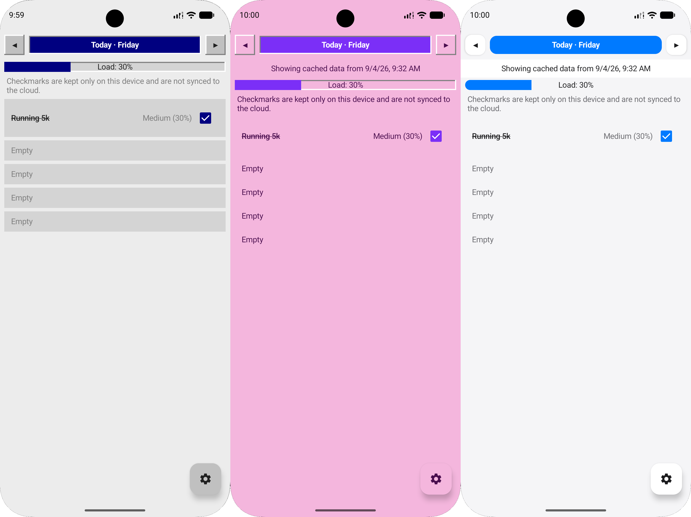

# Stapik Planner (Android)

A read-only mobile companion to [Stapik Planner](https://github.com/Stapik-Group/stapik-planner), the desktop weekly planner app. Written in Kotlin with Jetpack Compose, styled after the same retro old-school aesthetic as the desktop version and its sibling app.



## Features

- **Looping daily view** – swipe horizontally between the 7 weekdays, endlessly looping (Sun → Mon → ... → Sat → Sun); the app always opens on today
- **Local task checkoff** – tick off today's completed slots; kept only on this device (unencrypted local storage), never synced to the cloud, and never affects the source plan on the desktop app
- **Day load bar** – shows how loaded each day is (activity difficulty adds up to a 0–100%+ load, same formula as the desktop app)
- **Cloud sync (read-only)** – fetches the weekly plan from the Stapik Cloud compatible self-hosted API
- **Offline copy** – the last retrieved plan is kept on the device, encrypted with a key held in the Android Keystore (also when the cloud data is end-to-end encrypted), and shown at once on start while it is refreshed in the background
- **Themes** – Classic, Classic Pink, Modern, Dark and Neoclassic, matching the desktop app
- **Pull-to-refresh** – drag down to fetch the latest data on demand
- **Encrypted connection config** – server URL and API key are encrypted with a key held in the Android Keystore before being stored on device
- **End-to-end encryption** – an optional passphrase reads cloud data that the desktop app encrypted (`stapik-e2e`)
- **Multilingual UI** – Polish, English and German, following the phone's system language
- **Retro aesthetic** – same raised-button, blue-navbar, grey-cell look as the desktop app

This app does not edit the plan, its activity catalog, or slot configuration – all of that happens in the desktop app. It only reads and displays whatever is currently in the cloud, plus a small local-only "done today" overlay.

### What's intentionally not here

Unlike Stapik Calendar's companion app, this app has **no notifications** and **no home screen widget** — a deliberate scope decision for the planner companion.

## Requirements

- Android 8.0 (API 26) or newer
- A running instance of the Stapik Cloud compatible sync API used by the desktop app (see [Stapik Planner](https://github.com/Stapik-Group/stapik-planner))

## Building

Requires [Android Studio](https://developer.android.com/studio) (Kotlin, Jetpack Compose).

```
git clone --recurse-submodules https://github.com/Stapik-Group/stapik-planner-mobile
```

The app uses the shared library [stapik-common-mobile](https://github.com/Stapik-Group/stapik-common-mobile) as a git submodule in `libs/stapik-common-mobile`, pinned to a release tag. After a plain clone run `git submodule update --init`.

The library is built together with the app, so it needs the Android SDK location too: either set `ANDROID_HOME`, or copy `local.properties` into `libs/stapik-common-mobile/`.

To work on the library next to the app, put its path in `~/.gradle/gradle.properties`:

```
stapikCommonMobileDir=/path/to/stapik-common-mobile
```

Open the project folder in Android Studio, let Gradle sync, then build/run via the green Run button or:

```
./gradlew assembleDebug
```

The resulting APK is at `app/build/outputs/apk/debug/app-debug.apk`.

Pull requests from `develop` to `master` are built and tested by GitHub Actions; a `v*` tag builds a signed release APK (secrets `KEYSTORE_BASE64`, `KEYSTORE_PASSWORD`, `KEY_ALIAS`, `KEY_PASSWORD`).

## Installation

### Option 1 – install via Android Studio

Connect a device (USB or [wireless debugging](https://developer.android.com/tools/wireless-debugging)) or start an emulator, then hit Run in Android Studio.

### Option 2 – install a built APK manually

```
adb install app/build/outputs/apk/debug/app-debug.apk
```

Or transfer the APK to the device and open it directly (requires allowing installs from the source you used).

## Cloud Sync

On first launch, open the settings menu (gear icon, bottom right) – **Connect**, and enter the same server URL and API key configured on the desktop app (**File – Connect** there). If the desktop app encrypts the cloud data end to end, enter its passphrase as well.

The app fetches `planner.json` from the server whenever the plan screen comes to the foreground (on start, after connecting, when you return to the app) and whenever you pull to refresh. A banner above the plan tells why the data may be out of date (no connection, rejected key, missing or wrong passphrase). The sync API is fully compatible with **Stapik Cloud**.

Since this app is read-only, there's no write conflict to worry about on the mobile side – all conflict resolution (last-write-wins by timestamp) happens between desktop instances, as described in the [desktop app's README](https://github.com/Stapik-Group/stapik-planner#cloud-sync).

## Local task checkoff

Ticking a checkbox next to one of today's slots only writes to a file on the device, keyed by date, slot index and the activity planned in that slot. It is:

- **not** sent to the server,
- **not** part of the synced plan document,
- automatically irrelevant once the date rolls over (a new day starts with everything unchecked, no reset step needed),
- hidden when the activity in that slot changes in the plan, so a checkmark never ends up next to a different activity,
- pruned lazily after a couple of days so the local store doesn't grow forever.

If you want the desktop plan itself to reflect completed tasks, that's out of scope for this app by design — edit it there.
